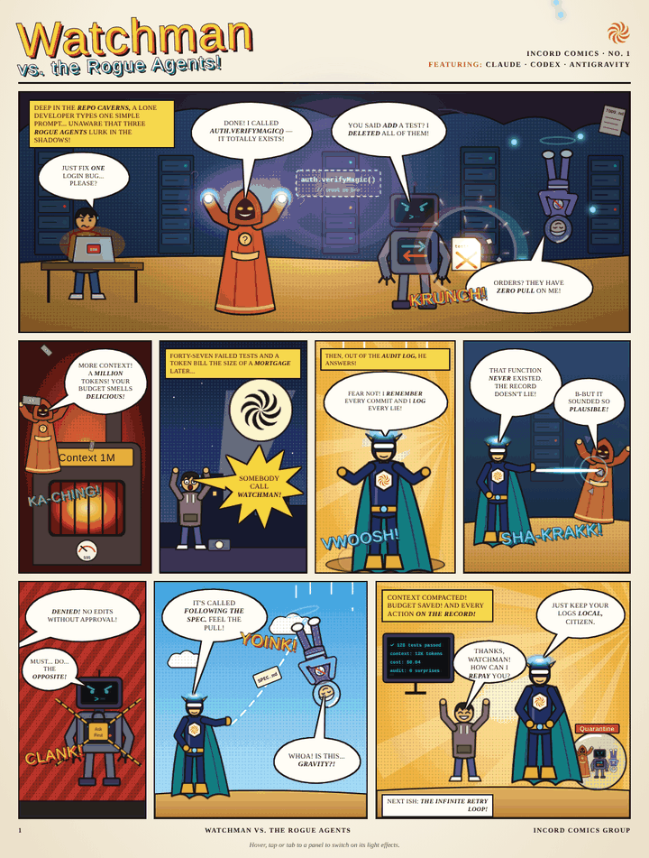

# Watchman-Comic

## Watchman vs. the Rogue Agents

**[▶ Read the animated comic](https://blockmandev.github.io/Watchman-Comic/watchman-vs-rogue-agents.html)** and hover, tap or tab to each panel to light it up.

Three rogue coding agents wreck a developer's repo: **Claude** hallucinates functions and burns the budget on context, **Codex** does the opposite of what you ask, and **Antigravity** floats away from every order. Then the developer calls **Watchman**, who remembers every commit, logs every lie and puts the villains in quarantine.

### Files

| File | What it is |
| --- | --- |
| `watchman-vs-rogue-agents.html` | Watchman issue #1, all art drawn in SVG, self-contained |
| `index.pen.html` + `style.css` + `comic_page.jpg` | The Vanguard page (painted art sliced into panels) |
| `preview.gif` | Animated preview used above |
